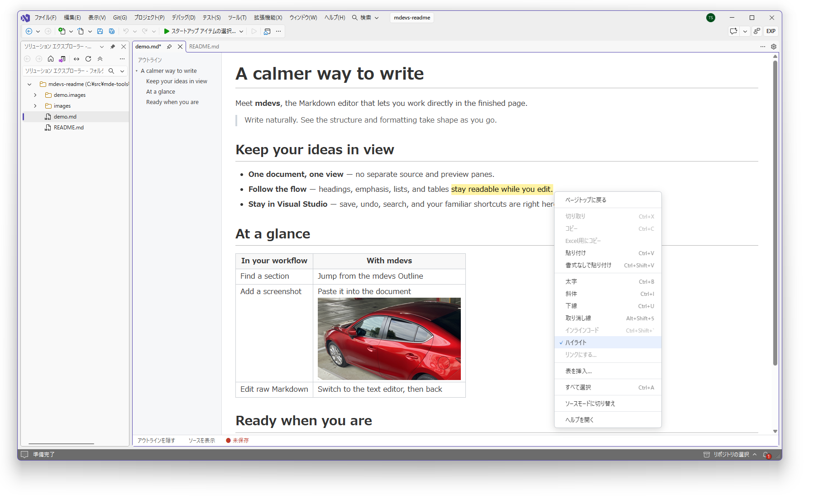
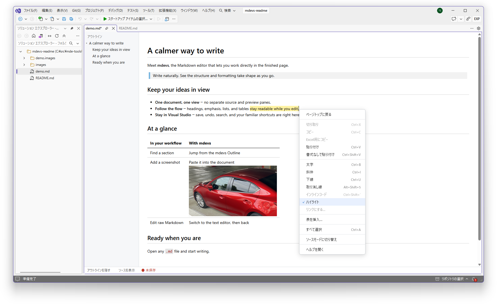
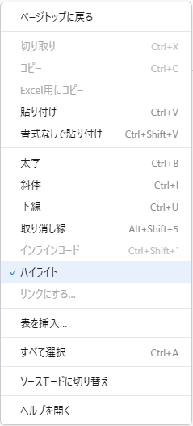
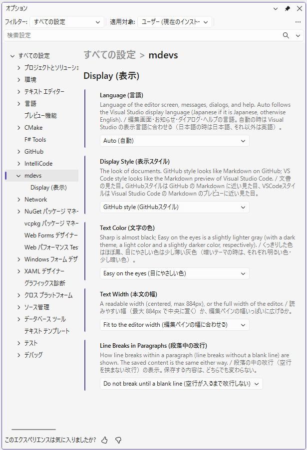

# mdevs — プレビューのまま Markdown を編集

**読むときと同じ見た目のまま、Visual Studio で Markdown を書けます。** mdevs は `.md` ファイルを、そのまま編集できる
ページとして開きます。見出し・箇条書き・表・画像は入力したそばから整形されます。ソースとプレビューの画面を
行き来する必要はなく、保存されるのは普通の Markdown のままです。

English: see [README.md](README.md).



## mdevs の特長

- **見たまま書いて、そのまま保存** — `## `・`**太字**`・`- `・`|a|b|` などを入力すると、記号を打ち終えた時点で
  書式になります。
- **差分がきれい** — 書き換えるのは実際に編集したブロックだけです。それ以外は読み込んだ時の空白や改行の位置を
  保つので、開いて保存しただけで Git の差分が増えることはありません。
- **表が扱いやすい** — Tab でセルを移動、`Ctrl+Enter` で行を追加、右クリックで行・列の挿入や削除ができます。
- **スクリーンショットを貼り付け** — `Ctrl+V` で画像を貼り付けると、保存した時にファイルの隣へ保存し、相対パスの
  リンクを入れます。
- **Excel・Word と連携** — Excel の範囲を貼り付けると Markdown の表になります。「Excel用にコピー」で見出し・
  箇条書き・表を Excel に1行1セルで貼り付けられ、通常のコピーは Word に書式付きで貼り付けられます。
- **いつもの Visual Studio のまま** — 保存・元に戻す・未保存の印・検索と置換・フォルダーを指定して検索・
  ショートカットは普段どおり。長い文書も、文書の横のアウトラインで見出しへすぐ移動できます。
- **2つの見た目、明るい・暗いテーマ対応** — GitHubスタイルと VSCodeスタイルを選べ、配色は Visual Studio の
  テーマに合わせて切り替わります。画面は日本語と英語に対応しています。

## 見た目を選べます

Visual Studio Code の Markdown プレビューの見た目が好みなら、オプションの「表示スタイル」を「VSCodeスタイル」に
します。どちらのスタイルでも編集機能は同じです。



## はじめかた

1. Visual Studio の「拡張機能」→「拡張機能の管理」で「mdevs」を検索して、インストールします。
2. `.md`・`.markdown` のファイルをソリューションエクスプローラー等から開くと、mdevs の編集画面で開きます。
3. 書いたら `Ctrl+S` で保存します。

対応する Visual Studio は Visual Studio 2022（バージョン 17.14 以降）と Visual Studio 2026 です（64 ビット）。編集画面の表示に Microsoft Edge
WebView2 ランタイムを使います（Windows 11 には最初から入っています）。

テキストとして編集したい時は、ソリューションエクスプローラーでファイルを右クリック→「ファイルを開くアプリケーションの
選択...」で「ソース コード (テキスト) エディター」を選んで開きます（同じ画面の「既定値として設定」で、既定の開き方も
変えられます）。

> **詳しいヘルプを内蔵しています。** 編集画面の右クリック→「ヘルプを開く」で、使い方の全体をまとめたヘルプ
> （読み取り専用）を、編集画面の言語で開きます。

## よく使う操作は右クリックから



編集画面を右クリックすると、よく使う操作をすぐに実行できます。

- ページトップに戻る
- 切り取り・コピー・**Excel用にコピー**・貼り付け・**書式なしで貼り付け**
- 太字・斜体・下線・取り消し線・インラインコード・ハイライト
- **リンクにする…**・**表を挿入…**
- リンクの上では **リンクを開く**・**URLをコピー**・**リンクを編集…**・**リンクを解除**
- 画像の上では **画像を開く**・**画像のサイズ**
- **ソースモードに切り替え**・**ヘルプを開く**

選んだ文字に付いている書式には ✓ が付きます。表のセルを右クリックすると表の操作、段落・見出しを右クリックすると
見出しのレベルの変更ができます。

<br clear="right">

## 書き方の早見表

| 作りたいもの | 入力（または操作） |
|---|---|
| 見出し | 行の先頭に `# `〜`###### ` |
| 引用 | 行の先頭に `> ` |
| 太字・斜体 | `**文字**`・`*文字*`、または `Ctrl+B`・`Ctrl+I` |
| 下線 | 文字を選んで `Ctrl+U` |
| 取り消し線・ハイライト | `~~文字~~`（`Alt+Shift+5`）・`==文字==` |
| インラインコード | `` `文字` `` |
| 箇条書き・番号付きリスト | 行の先頭に `- `・`1. ` |
| チェックボックス | 項目の先頭に `[ ] ` または `[x] ` |
| コードブロック | ```` ``` ````（言語名も可）を入力して Enter |
| 横線 | `---` を入力して Enter |
| 表 | `\|見出し1\|見出し2\|` を入力して Enter、または「表を挿入…」 |
| リンク | `[文字](URL)`、または文字を選んで「リンクにする…」 |

**箇条書き：** Enter で次の項目、Tab・Shift+Tab で字下げ・字下げ解除、Shift+Enter で項目の中で改行、
空の項目で Enter を押すと箇条書きを抜けます。
**表：** Tab・Shift+Tab でセルを移動（最後のセルで Tab を押すと行を追加）、Enter で下のセルへ移動、Shift+Enter でセルの中で改行、
Ctrl+Enter で下に行を挿入します。

## 検索・移動・ソースの表示

- **検索と置換** — Visual Studio の検索を使います。

  | 操作 | キー |
  |---|---|
  | 検索と置換のウィンドウを開く | Ctrl+F・Ctrl+H |
  | 次を検索・前を検索 | F3・Shift+F3 |

  「すべて置換」は、Markdown のソースに対して置き換えます（「**」やリンクの URL なども対象になります）。
- **フォルダーを指定して検索** — `Ctrl+Shift+F`・`Ctrl+Shift+H` もそのまま使えます。置換した結果は、開いている
  mdevs の画面にもすぐに反映されます。「検索結果」の行をダブルクリックすると、ファイルを開いてその箇所を表示します。
- **アウトライン** — 編集画面の左側に、今の文書の見出しの一覧を表示します。クリックでその見出しへ移動します。
  ステータスバーの「アウトラインを隠す」「アウトラインを表示」のボタンで、表示・非表示を切り替えられます。
- **ソースモード** — 画面下のステータスバーの「ソースを表示」（または右クリック→「ソースモードに切り替え」）で
  Markdown のソースを表示し、「Markdownを表示」で戻ります。
- **表示倍率** — `Ctrl++`・`Ctrl+-`・`Ctrl+0`、または Ctrl+マウスホイール。

## 画像とリンク

クリップボードの画像を `Ctrl+V` で貼り付けると、保存するまでの間は一時フォルダに置き、保存した時に、編集している
ファイルの隣の「`<ファイル名>.images`」フォルダへ `clipboard_image_1.png` のような名前で移して、相対パスのリンクを
文書に書きます。「名前を付けて保存」で別のフォルダに保存した時は、相対パスの画像も、新しい保存先から見て同じ位置へ
コピーします。画像を右クリック→「**画像のサイズ**」で、表示の大きさを元の 25%〜200% に変えられます。
大きさは `width` 属性で保存されるので、GitHub や Typora でも同じ大きさで表示されます。

リンクはクリックで開きます。Web のリンクはブラウザで、`#見出し` のリンクは文書の中で、相対パスで書いた Markdown
ファイルへのリンクは Visual Studio の別のタブで開きます。

## キー操作

編集画面で使うキー（文字の入力、太字の Ctrl+B・斜体の Ctrl+I・下線の Ctrl+U、元に戻す・やり直し、コピー・貼り付け、
表示倍率の Ctrl++・Ctrl+-・Ctrl+0、取り消し線の Alt+Shift+5 等）は、編集画面が受け取ります。
それ以外のキー（Ctrl+S・Ctrl+Tab・F5・Ctrl+Shift+B 等）は、Visual Studio のショートカットとして動きます。

## 設定



Visual Studio の「ツール」→「オプション」→「mdevs」→「Display (表示)」で、次の設定を変えられます。変えた設定は、
開いているすべての画面にすぐに反映されます。

| 設定 | 内容 |
|---|---|
| 言語 | 自動（既定。Visual Studio の表示言語に合わせる：日本語の時は日本語、それ以外は英語）／日本語／English（英語） |
| 表示スタイル | GitHubスタイル（既定）／VSCodeスタイル |
| 文字の色 | くっきりした色（既定）／目にやさしい色 |
| 本文の幅 | 読みやすい幅にする（最大 884px。既定）／編集ペインの幅に合わせる |
| 段落中の改行 | 空行が入るまで改行しない（既定）／ソースの通りに改行する（表示だけの違いで、保存する内容は同じです） |

「言語」は、編集画面・お知らせ・ダイアログ・ヘルプに使います。オプションの画面自体は Visual Studio が表示するので、
項目名は英語と日本語を並べて書いてあります。配色（明るい・暗い）は、Visual Studio の配色に合わせて自動で
切り替わります。

## 制限事項

- `Ctrl+F`・`Ctrl+H` では「検索と置換」のウィンドウが開きます。小さな検索の枠（クイック検索）はテキストエディター用で、
  mdevs では使えません。
- 「Excel用にコピー」で貼り付けた画像が、Excel で下の行の文字に重なって表示されることがあります。

## VSIX ファイルからのインストール

1. Visual Studio をすべて閉じます。
2. 配布された `mdevs.vsix` をダブルクリックすると、VSIX インストーラーが開くので、画面の指示に従ってインストールします。

アンインストールは、Visual Studio の「拡張機能」→「拡張機能の管理」で mdevs を選んで行います。

## 開発

### フォルダの構成

| 場所 | 内容 |
|---|---|
| `mdevs.slnx` | ソリューション |
| `mdevs/mdevsPackage.cs` | 拡張機能の入り口（エディターの登録・オプションのページの登録） |
| `mdevs/MarkdownEditorFactory.cs` | `.md`・`.markdown` を開く時に、編集ペインを作るエディターファクトリー |
| `mdevs/MarkdownEditorPane.cs` | 編集ペイン（Visual Studio の文書としての読み込み・保存、検索、ほかのアプリでの変更の検知等） |
| `mdevs/MarkdownWebHost.cs` | 編集ペインの中身（WebView2 で画面を表示し、ファイルの読み書き・画像の貼り付け・リンクを開く等を受け持つ） |
| `mdevs/KeyboardRouter.cs` | キー入力を、Visual Studio のショートカットと編集画面とに振り分ける |
| `mdevs/NavigationCapture.cs` | 「検索結果」から開いた時に、その箇所を表示する |
| `mdevs/MdevsOptionsPage.cs`・`MdevsSettings.cs`・`registration.json` | 「ツール」→「オプション」の設定 |
| `mdevs/UiThread.cs`・`Log.cs` | UI スレッドでの処理、動作の記録（「出力」ウィンドウの「mdevs」） |
| `mdevs/dialog/` | 「表を挿入…」「リンクにする…」「リンクを編集…」のダイアログ |
| `mdevs/help/HELP.md`・`HELP.en.md` | ヘルプの日本語・英語（右クリックの「ヘルプを開く」で、読み取り専用で開く。編集画面の言語のものを開く） |
| `mdevs/web/` | 画面（HTML・JavaScript・CSS）。`js/i18n.js` は画面の英語（日本語の文字をキーにした辞書） |
| `mdevs/Text.cs` | 拡張機能が出すお知らせ・ダイアログの英語（日本語の文字をキーにした辞書） |
| `mdevs/images/mde.png` | 拡張機能のアイコン |
| `mdevs/LICENSE.txt` | VSIX に入れるライセンス（mdevs の MIT License と、WebView2 のライセンス） |
| `mdevs/source.extension.vsixmanifest` | 拡張機能の情報（名前・バージョン・発行者・対応する Visual Studio 等） |
| `README.md`・`README.ja.md` | 説明（英語。Marketplace の拡張機能のページに使う）・この文書（日本語） |
| `images/readme/` | README で使う画面の画像（英語の README は GitHub から読み込むので、公開する前に push しておく） |

### 動作の確認

1. Visual Studio 2026 に「Visual Studio 拡張機能の開発」のワークロードを入れておきます。
2. `mdevs.slnx` を開いてビルドします。
3. F5 を押すと、mdevs を読み込んだ Visual Studio（実験用インスタンス）が起動するので、`.md` ファイルを開いて確かめます。
4. 動作の記録は「表示」→「出力」の「出力元」で「mdevs」を選ぶと表示されます。画面側は、編集画面で F12 を押すと開発者ツールが開きます。

### 配布用の VSIX の作り方

構成を「Release」にしてビルドすると、`mdevs\bin\Release\net472\mdevs.vsix` ができます。これが配布するファイルです。
バージョンは `source.extension.vsixmanifest` の `Version`（VSIX のバージョン）と、`mdevs.csproj` の `Version`（DLL のバージョン）で変えます。

## ライセンス

MIT License（LICENSE.txt）。mdevs が使用している WebView2 のライセンスは `mdevs\LICENSE.txt` にあります。
