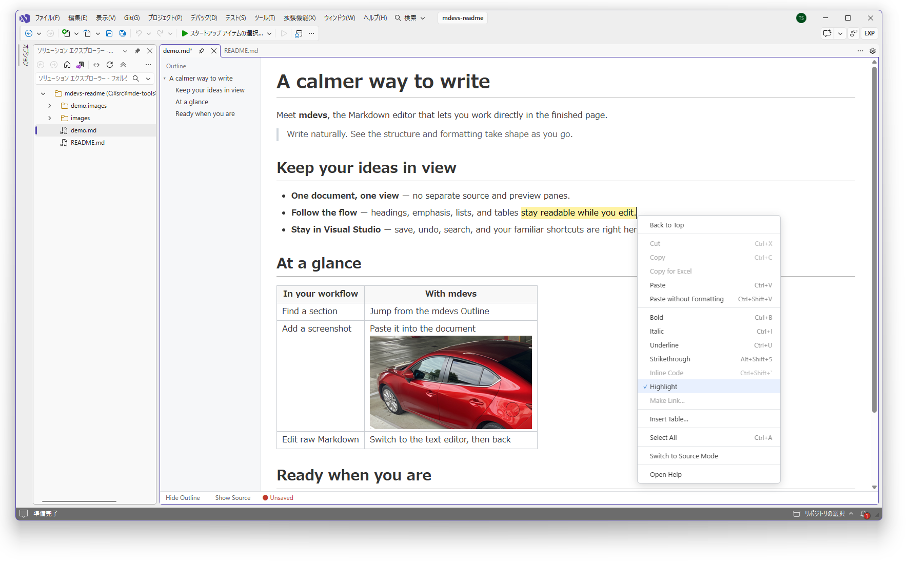
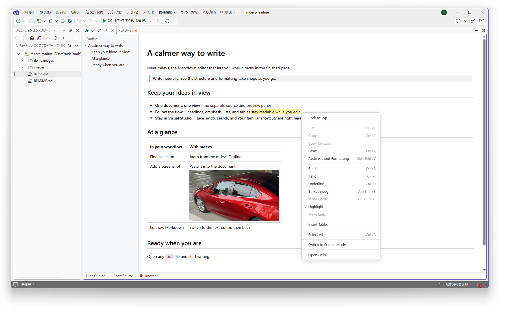
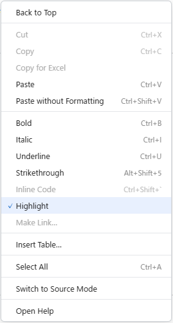
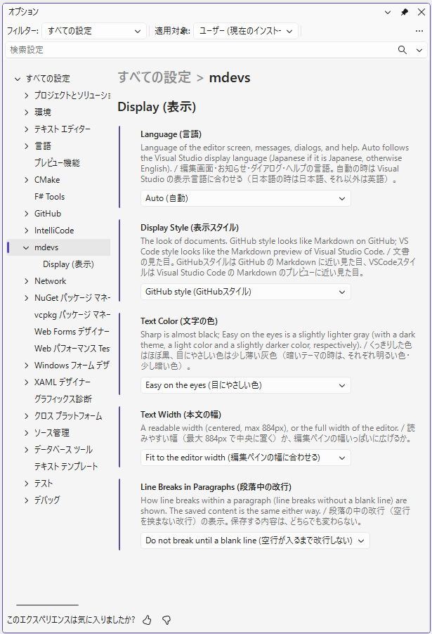

# mdevs — Edit Markdown right in the preview

**Write Markdown in Visual Studio the way you read it.** mdevs turns `.md` files into a page you edit directly:
headings, lists, tables, and images take shape as you type. No source pane, no preview pane, no switching back and
forth — and the file you save is still plain Markdown.

日本語の説明は [README.ja.md](https://github.com/mde-tools/mdevs/blob/master/README.ja.md) を参照してください。



## Why mdevs

- **One view, what you see is what you save** — Type `## `, `**bold**`, `- `, or `|a|b|` and the formatting appears
  as soon as you finish the mark.
- **Clean diffs** — Only the blocks you actually edit are rewritten. Everything else keeps its original spacing and
  line breaks, so opening and saving a file does not fill your Git diff with noise.
- **Tables that are easy to work with** — Tab between cells, add rows with `Ctrl+Enter`, and insert or delete rows and
  columns from the right-click menu.
- **Paste screenshots** — `Ctrl+V` pastes an image; when you save, it is stored next to your file and linked with a
  relative path.
- **Works with Excel and Word** — Paste an Excel range to get a Markdown table. "Copy for Excel" sends headings,
  lists, and tables back to Excel one cell per line; normal copy pastes into Word with formatting.
- **Still Visual Studio** — Save, undo, the unsaved-changes marker, Find and Replace, Find in Files, and your shortcuts
  behave as usual. An outline next to the document lets you jump through long documents.
- **Two looks, light or dark** — GitHub style or VS Code preview style, following your Visual Studio color theme.
  English and Japanese UI.

## Choose your style

Prefer the look of the Visual Studio Code Markdown preview? Switch **Display Style** in the options. The editing
features are the same in both styles.



## Get started

1. In Visual Studio, open **Extensions > Manage Extensions**, search for "mdevs", and install it.
2. Open any `.md` or `.markdown` file from Solution Explorer or elsewhere. It opens in mdevs.
3. Write, then save with `Ctrl+S`.

Requires Visual Studio 2026 (version 18.0 or later, 64-bit). The editor uses the Microsoft Edge WebView2 Runtime
(included with Windows 11).

To edit a file as plain text, right-click the file in Solution Explorer → **Open With...**, and choose
**Source Code (Text) Editor** (click **Set as Default** in the same dialog to change the default way of opening).

> **Full help is built in.** Right-click in the editor → **Open Help** opens a complete, read-only guide in the
> language of the editor.

## Everything at your right click



Right-click in the document for the commands you use most:

- Back to Top
- Cut, Copy, **Copy for Excel**, Paste, **Paste without Formatting**
- Bold, Italic, Underline, Strikethrough, Inline Code, Highlight
- **Make Link…** and **Insert Table…**
- On a link: **Open Link**, **Copy URL**, **Edit Link…**, and **Remove Link**
- **Switch to Source Mode** and **Open Help**

Commands that already apply to the selection are checked (✓). Right-click a table cell for table commands, and a
paragraph or heading to change the heading level.

<br clear="right">

## Writing at a glance

| To get | Type (or use) |
|---|---|
| Heading | `# ` to `###### ` at the start of a line |
| Quote | `> ` at the start of a line |
| Bold / Italic | `**text**` / `*text*`, or `Ctrl+B` / `Ctrl+I` |
| Underline | Select text and press `Ctrl+U` |
| Strikethrough / Highlight | `~~text~~` (`Alt+Shift+5`) / `==text==` |
| Inline code | `` `text` `` |
| Bulleted / numbered list | `- ` / `1. ` at the start of a line |
| Check box | `[ ] ` or `[x] ` at the start of a list item |
| Code block | ```` ``` ```` (optionally with a language) and Enter |
| Horizontal rule | `---` and Enter |
| Table | `\|Header 1\|Header 2\|` and Enter, or **Insert Table…** |
| Link | `[text](URL)`, or select text → **Make Link…** |

**Lists:** Enter adds an item, Tab / Shift+Tab indents / outdents, Shift+Enter breaks the line inside an item,
and Enter on an empty item leaves the list.
**Tables:** Tab / Shift+Tab move between cells (Tab in the last cell adds a row), Enter moves to the cell below,
Shift+Enter breaks the line inside a cell, Ctrl+Enter inserts a row below.

## Find, navigate, and view the source

- **Find and replace** — Uses the Visual Studio search.

  | Operation | Keys |
  |---|---|
  | Open the Find and Replace window | Ctrl+F / Ctrl+H |
  | Find next / previous | F3 / Shift+F3 |

  "Replace All" works on the Markdown source (so `**`, link URLs, and so on are also replaced).
- **Find in Files** — `Ctrl+Shift+F` / `Ctrl+Shift+H` work as usual, and replacements show up immediately in open
  mdevs editors. Double-click a line in "Find Results" to open the file and show the match.
- **Outline** — The left side of the editor lists the headings of the current document. Click one to jump to it.
  The **Hide Outline** / **Show Outline** button in the status bar shows or hides it.
- **Source mode** — **Show Source** in the status bar at the bottom of the editor (or right-click →
  **Switch to Source Mode**) shows the raw Markdown; **Show Markdown** switches back.
- **Zoom** — `Ctrl++`, `Ctrl+-`, `Ctrl+0`, or Ctrl+mouse wheel.

## Images and links

Paste an image from the clipboard with `Ctrl+V`. It is kept in a temporary folder until you save; when you save, it
is moved into a `<file name>.images` folder next to the file (for example `clipboard_image_1.png`), and a relative
link is written into the document. With Save As to another folder, images with relative paths are copied so that they
stay at the same relative location.

Links open with a single click: web links in your browser, `#heading` links inside the document, and relative links to
other Markdown files in a new Visual Studio tab.

## Keyboard

Keys for editing (typing, Ctrl+B / Ctrl+I / Ctrl+U, Alt+Shift+5, undo / redo, copy / paste, zoom, etc.) are handled by
the editor. Other keys (Ctrl+S, Ctrl+Tab, F5, Ctrl+Shift+B, etc.) work as Visual Studio shortcuts.

## Settings



Open **Tools > Options > mdevs > Display**. Changes apply immediately to all open editors.

| Setting | Values |
|---|---|
| Language | Auto (default; follows the Visual Studio display language: Japanese if it is Japanese, otherwise English) / Japanese / English |
| Display Style | GitHub style (default) / VS Code style |
| Text Color | Sharp (default) / Easy on the eyes |
| Text Width | Readable width (max 884px, default) / Fit to the editor width |
| Line Breaks in Paragraphs | Do not break until a blank line (default) / Break lines as in the source. Display only; the saved file is the same. |

The Language setting applies to the editor screen, messages, dialogs, and the help. The options page itself is shown
by Visual Studio, so its labels are written in both English and Japanese. Light and dark appearance follows your
Visual Studio color theme.

## Known limitations

- `Ctrl+F` / `Ctrl+H` open the Find and Replace window. The small Quick Find box is for text editors and cannot be used
  in mdevs.
- With "Copy for Excel", images may be shown over the text of the row below in Excel.

## Install from a VSIX file

1. Close all instances of Visual Studio.
2. Double-click the `mdevs.vsix` file. The VSIX Installer opens; follow the instructions on the screen.

To uninstall, choose mdevs in Visual Studio under **Extensions > Manage Extensions**.

## Development

### Folder structure

| Path | Contents |
|---|---|
| `mdevs.slnx` | Solution |
| `mdevs/mdevsPackage.cs` | Entry point of the extension (registers the editor and the options page) |
| `mdevs/MarkdownEditorFactory.cs` | Editor factory that creates the editor pane when a `.md` or `.markdown` file is opened |
| `mdevs/MarkdownEditorPane.cs` | Editor pane (loading and saving as a Visual Studio document, find, detecting changes by other apps, etc.) |
| `mdevs/MarkdownWebHost.cs` | Contents of the editor pane (shows the screen with WebView2; reads and writes files, pastes images, opens links, etc.) |
| `mdevs/KeyboardRouter.cs` | Routes key input between Visual Studio shortcuts and the editor screen |
| `mdevs/NavigationCapture.cs` | Shows the match when a file is opened from "Find Results" |
| `mdevs/MdevsOptionsPage.cs`, `MdevsSettings.cs`, `registration.json` | Settings under Tools > Options |
| `mdevs/UiThread.cs`, `Log.cs` | Work on the UI thread, and the log (the "mdevs" pane of the Output window) |
| `mdevs/dialog/` | The "Insert Table…", "Make Link…", and "Edit Link…" dialogs |
| `mdevs/help/HELP.en.md`, `HELP.md` | Help in English / Japanese (opened read-only from the right-click menu → Open Help. The one for the language of the editor is opened) |
| `mdevs/web/` | Editor screen (HTML, JavaScript, CSS). `js/i18n.js` holds the English text of the screen (the Japanese text is the key) |
| `mdevs/Text.cs` | English text of the messages and dialogs shown by the extension (the Japanese text is the key) |
| `mdevs/images/mde.png` | Icon of the extension |
| `mdevs/LICENSE.txt` | License included in the VSIX (the mdevs MIT License and the WebView2 license) |
| `mdevs/source.extension.vsixmanifest` | Information about the extension (name, version, publisher, supported Visual Studio, etc.) |
| `README.md`, `README.ja.md` | This file (English) / Japanese version |
| `images/readme/` | Screenshots used in the README (the English README loads them from GitHub, so push them before publishing) |

### Trying it out

1. Install the "Visual Studio extension development" workload in Visual Studio 2026.
2. Open `mdevs.slnx` and build.
3. Press F5 to start Visual Studio with mdevs loaded (the experimental instance), and open a `.md` file.
4. The log is shown under View > Output by choosing "mdevs" in "Show output from". For the editor screen itself, press
   F12 in the editor to open the developer tools.

### Building the VSIX

Build with the "Release" configuration to create `mdevs\bin\Release\net472\mdevs.vsix`. This is the file to distribute.
Change the version with `Version` in `source.extension.vsixmanifest` (the VSIX version) and `Version` in
`mdevs.csproj` (the DLL version).

## License

MIT License (LICENSE.txt). The license of WebView2, which mdevs uses, is in `mdevs\LICENSE.txt`.
